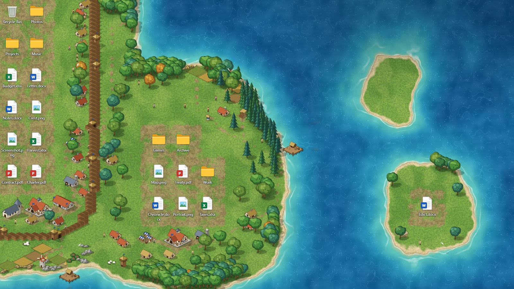
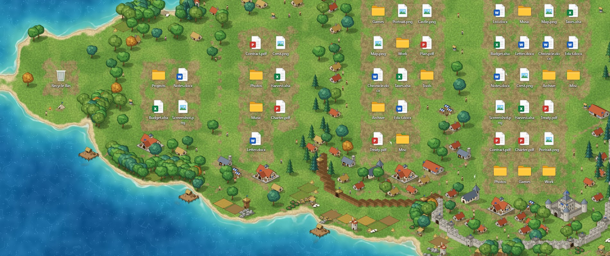

# Fief

**Un fond d'écran vivant pour Windows, qui bâtit un royaume médiéval autour des icônes de votre bureau.**

**[Site et démo en direct](https://adchouchet.github.io/fief/)** · **[Télécharger](https://github.com/adchouchet/fief/releases/latest)** · [English](README.md)



Fief lit la position des icônes de votre bureau — seulement leur position,
jamais les noms ni les contenus — et fait pousser un monde autour d'elles.
Chaque groupe d'icônes fonde une colonie sur son île. Déplacez, ajoutez ou
supprimez une icône : la côte se redessine, les bâtiments devenus inutiles sont
démolis, les nouveaux sortent de terre avec leur chantier.

## Du feu de camp à la cité fortifiée

| Icônes regroupées | Colonie | Ce qui apparaît |
| --- | --- | --- |
| 1 à 2 | Campement | tentes, feu de camp |
| 3 à 5 | Hameau | forum, chaumières, champs, camp de bûcherons, ponton |
| 6 à 11 | Village | moulin, marché, forge, mine, tour de guet, chapelle |
| 12 à 19 | Bourg | caserne, palissade avec tours et portes |
| 20 et plus | Cité | château, remparts de pierre, deux pontons |



Les villageois coupent du bois, cultivent, minent et bâtissent ; les moutons
broutent ; barques de pêche et navires marchands prennent la mer ; des chemins
de terre relient le forum aux portes et aux ateliers.

## Télécharger et lancer

1. Récupérez `Fief-x.y.z-win-x64.zip` dans la [dernière version](../../releases/latest).
2. Décompressez-le où vous voulez et lancez `Fief.exe`.

Fief se loge près de l'horloge sous la forme d'un petit écu bleu. Clic droit
dessus : **Réglages**, **Écrans**, **Mettre en pause**, **Recharger le monde**,
**Lancer au démarrage de Windows**, **Quitter**. Relancer `Fief.exe` ouvre les
réglages ; `Fief.exe --exit` le ferme et rend le fond d'origine.

Le programme n'est pas encore signé : au premier lancement, Windows peut
afficher « Windows a protégé votre ordinateur ». Choisissez *Informations
complémentaires*, puis *Exécuter quand même*.

**Configuration :** Windows 10 ou 11 (64 bits) et le composant Microsoft Edge
WebView2 Runtime, présent sur les Windows à jour.

## Réglages

- **Écrans couverts** — un seul monde continu sur tous les écrans, ou un seul
  écran (les autres gardent leur fond).
- **Carte** — *Archipel* (la mer partout, les icônes font surgir des îles),
  *Côtes* ou *Continent* (une grande forêt où les icônes ouvrent des
  clairières), et la graine du monde.
- **Autour des icônes** — espace dégagé, taille des terres, sinuosité des côtes.
- **Monde** — taille du monde, forêts, population, animaux, navires, brouillard
  de guerre, couleur du joueur.
- **Application** — 15, 30 ou 60 images par seconde, démarrage avec Windows.

L'interface suit la langue de Windows (français ou anglais). Les réglages sont
enregistrés dans `%LOCALAPPDATA%\Fief`.

## Bon à savoir

- **Vie privée.** Fief demande seulement à Windows le rectangle occupé par
  chaque icône du bureau. Il n'ouvre aucune connexion réseau.
- **Discret.** Il cesse de dessiner quand des fenêtres agrandies ou en plein
  écran couvrent tous les écrans qu'il occupe, et quand la session est
  verrouillée.
- **Échelle d'affichage.** Le monde suit l'échelle de Windows (125 %, 150 %…),
  et le réglage *Taille du monde* permet de le grossir ou de le réduire.
- **Autres fonds animés.** Fief se place devant Wallpaper Engine, Lively et
  consorts sur les écrans qu'il couvre. Mettez l'autre en pause sur ces écrans
  pour ne pas faire travailler la carte graphique deux fois.

### Limites connues

- Développé et testé sous Windows 10 (22H2). Le chemin de code pour
  Windows 11 24H2 et suivants est écrit mais n'a pas encore tourné sur ce
  système.
- Certains antivirus se méfient des programmes qui demandent au bureau la
  position des icônes. Tout le code est ici, à vérifier ou à compiler soi-même.
- Programme non signé.

## Compiler

Il faut le SDK .NET (8 ou plus récent). Le programme vise .NET Framework 4.8,
fourni avec Windows.

```powershell
powershell -ExecutionPolicy Bypass -File build.ps1
dist\Fief.exe
```

`build.ps1` produit `dist\` (prêt à lancer), `release\Fief-x.y.z-win-x64.zip`,
et met à jour la démo en ligne dans `docs\demo\`.

Pour travailler sur le monde dans un navigateur, avec de fausses icônes à
déplacer :

```powershell
node tools/serve.mjs            # la page du fond d'écran, http://localhost:5180/
node tools/serve.mjs docs 5181  # le site du projet, http://localhost:5181/
```

Adresses utiles : `/?map=continent&debug=1`, `/?layout=tiers`, `/?zoom=1.5`
(tout réglage de `theme/js/config.js` peut passer dans l'adresse),
`/settings.html`, `/sprites.html` (la planche de tous les éléments dessinés).

Options de mise au point de l'exécutable : `--debug` (compteur d'images et
contour des rectangles d'icônes reçus), `--devtools`,
`--screen gauche|droite|tous|N`, `--snapshot fichier.png [secondes]`
(enregistre ce que dessine la page, sans vos icônes).

## Comment c'est fait

| Dossier | Rôle |
| --- | --- |
| `host/` | Le programme Windows (C#, .NET Framework 4.8). Glisse une fenêtre WebView2 derrière les icônes, lit leurs rectangles toutes les 400 ms et les transmet à la page. |
| `theme/` | La page qui dessine le monde. Fonctionne aussi seule dans un navigateur. |
| `theme/js/field.js` | Champs de terrain calculés à partir des icônes : hauteur, terre battue, sous-bois, brouillard. |
| `theme/js/ground.js` | Sol en WebGL : mer, écume, plage, herbe. |
| `theme/js/sprites.js`, `iso.js` | Chaque bâtiment, arbre et rocher est dessiné par code. Il n'y a aucun fichier image. |
| `theme/js/world.js` | Urbanisme : colonies, bâtiments, remparts, chemins, ressources, forêts. |
| `theme/js/agents.js` | Villageois, moutons, cerfs, bateaux, oiseaux, fumée. |
| `theme/js/scene.js` | Calques statique et dynamique, gestion de la profondeur. |
| `docs/` | Le site du projet, avec la démo en direct. |

## Crédits et licence

L'idée d'un fond d'écran qui pousse autour des icônes vient de
[Deskland](https://deskland.app/). Fief en reprend le principe ; son code et
ses dessins sont originaux. Fief est un projet indépendant, sans lien avec un
éditeur de jeux.

Fief est un logiciel libre sous [licence publique générale GNU v3](LICENSE).
Il utilise le SDK Microsoft Edge WebView2 (BSD-3-Clause, © Microsoft).
