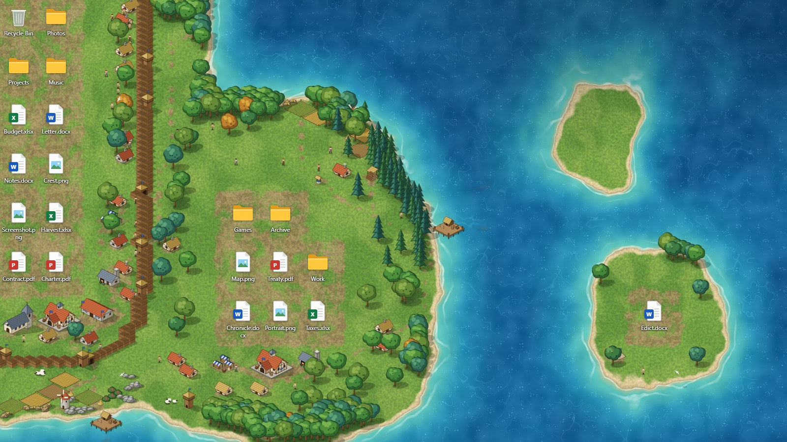
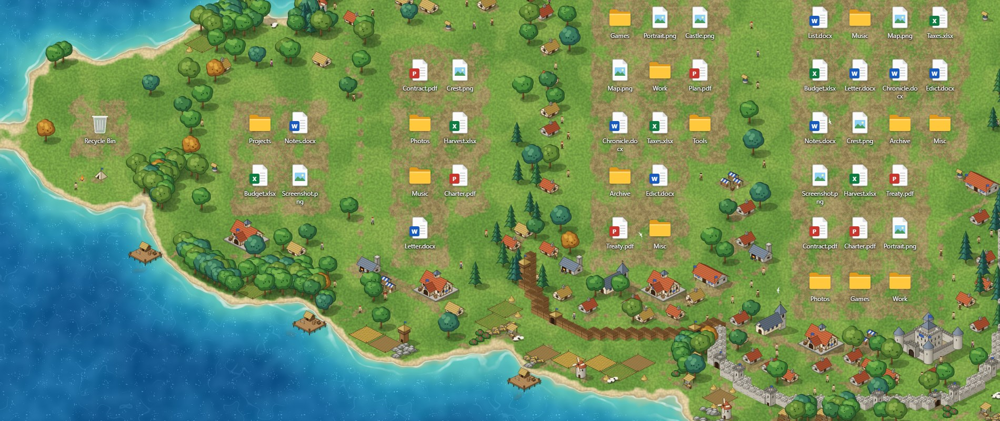
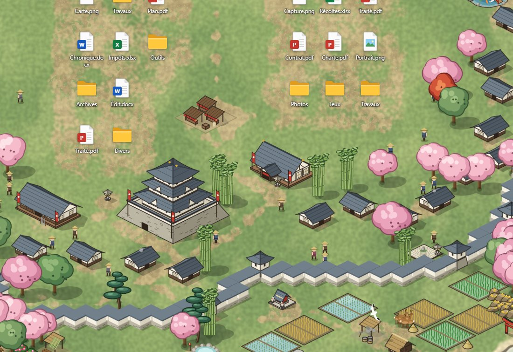
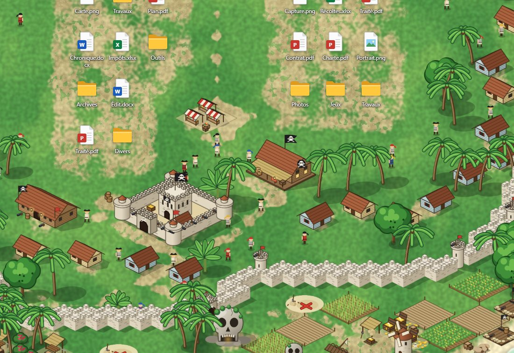
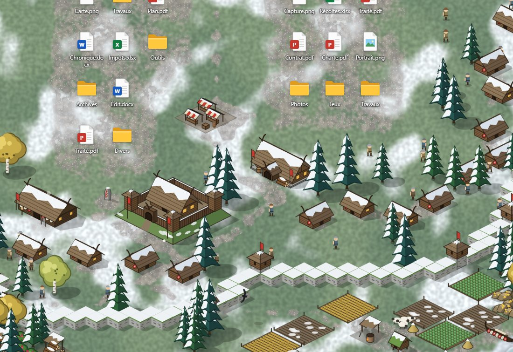
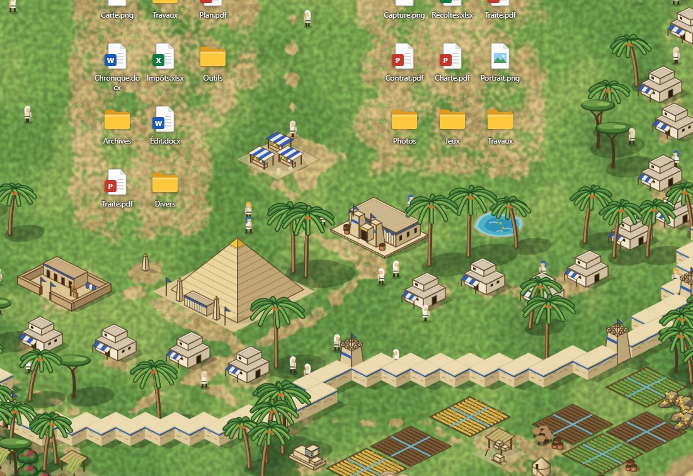
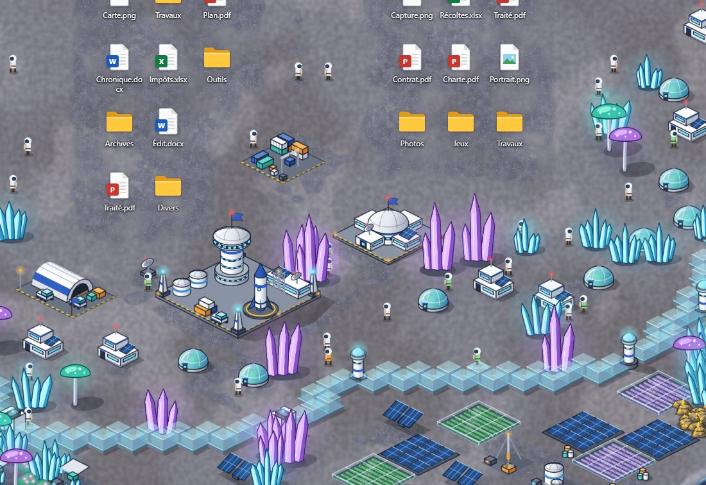

# Fief

**A living wallpaper for Windows that builds a medieval kingdom around your desktop icons.**

**[Website and live demo](https://adchouchet.github.io/fief/)** · **[Download](https://github.com/adchouchet/fief/releases/latest)** · [Français](README.fr.md)



Fief reads where your desktop icons sit — only their position, never names or
contents — and grows a world around them. Every group of icons founds a
settlement on its own island. Move, add or delete an icon and the coastline
redraws itself, buildings that are no longer needed are pulled down, and new
ones rise from their scaffolding.

## From a campfire to a walled city

| Icons grouped | Settlement | What appears |
| --- | --- | --- |
| 1–2 | Camp | tents, a campfire |
| 3–5 | Hamlet | town hall, cottages, fields, lumber camp, jetty |
| 6–11 | Village | windmill, market, forge, mine, watchtower, chapel |
| 12–19 | Walled town | barracks, a palisade with towers and gates |
| 20+ | City | castle, stone ramparts, two jetties |



Villagers chop wood, farm, mine and build; sheep graze; fishing boats and
merchant ships sail; dirt paths link the town hall to the gates and workshops.

## Five more worlds on itch.io

The medieval kingdom is free and stays free. Five more worlds come with the version sold on [itch.io](https://adchouchet.itch.io/fief) for $2.20: the same idea, a different world each time. You pick yours in Settings, under Theme.

| Feudal Japan | Pirate isles | Northern fjords |
| :---: | :---: | :---: |
|  |  |  |

| Oasis of Egypt | Star colony |
| :---: | :---: |
|  |  |

**[Get the six worlds on itch.io](https://adchouchet.itch.io/fief)**. Buying them is what funds further work on Fief.

## Download and run

1. Get `Fief-x.y.z-win-x64.zip` from the [latest release](../../releases/latest).
2. Unzip it anywhere and run `Fief.exe`.

Fief lives near the clock as a small blue shield. Right-click it for
**Settings**, **Screens**, **Pause**, **Reload the world**,
**Start with Windows** and **Quit**. Running `Fief.exe` again opens the
settings; `Fief.exe --exit` closes it and gives your previous wallpaper back.

The program is not code-signed yet, so Windows may show "Windows protected your
PC" on first launch: choose *More info*, then *Run anyway*.

**Requirements:** Windows 10 or 11 (64-bit) and the Microsoft Edge WebView2
Runtime, which ships with up-to-date Windows.

## Settings

- **Screens covered** — one continuous world across all screens, or a single
  screen (the others keep their own wallpaper).
- **Map** — *Islands* (sea everywhere, icons raise islands), *Coasts*, or
  *Mainland* (one great forest where icons open clearings), plus the world seed.
- **Around the icons** — clear space, land size, coastline wobble.
- **World** — world scale, forests, population, animals, ships, fog of war,
  player colour.
- **Application** — 15, 30 or 60 frames per second, start with Windows.

The interface follows the Windows language (English or French). Settings are
stored in `%LOCALAPPDATA%\Fief`.

## Good to know

- **Privacy.** Fief asks Windows only for the rectangle each desktop icon
  occupies. It makes no network connection.
- **Quiet.** It stops drawing when maximised or full-screen windows cover every
  screen it occupies, and when the session is locked.
- **Display scaling.** The world follows the Windows display scale (125 %,
  150 %…), and *World scale* lets you make it bigger or smaller.
- **Other animated wallpapers.** Fief places itself in front of Wallpaper
  Engine, Lively and the like on the screens it covers. Pause the other one
  there to avoid working the graphics card twice.

### Known limitations

- Developed and tested on Windows 10 (22H2). The code path for
  Windows 11 24H2 and later is written but has not been run on that system yet.
- Some antivirus tools are wary of programs that ask the desktop for icon
  positions. The full source is here for anyone to check or build.
- Not code-signed.

## Build from source

Requires the .NET SDK (8 or later). The program itself targets .NET Framework
4.8, which is part of Windows.

```powershell
powershell -ExecutionPolicy Bypass -File build.ps1
dist\Fief.exe
```

`build.ps1` produces `dist\` (ready to run), `release\Fief-x.y.z-win-x64.zip`,
and refreshes the online demo in `docs\demo\`.

To work on the world in a browser, with fake icons you can drag:

```powershell
node tools/serve.mjs            # the wallpaper page, http://localhost:5180/
node tools/serve.mjs docs 5181  # the project website, http://localhost:5181/
```

Useful addresses: `/?map=continent&debug=1`, `/?layout=tiers`, `/?zoom=1.5`
(any setting from `theme/js/config.js` can go in the address),
`/settings.html`, `/sprites.html` (every drawn element on one sheet).

Debugging options for the executable: `--debug` (frame counter and outline of
the icon rectangles received), `--devtools`, `--screen left|right|all|N`,
`--snapshot file.png [seconds]` (saves what the page draws, without your icons).

## How it is made

| Folder | Role |
| --- | --- |
| `host/` | The Windows program (C#, .NET Framework 4.8). Slides a WebView2 window behind the desktop icons, reads their rectangles every 400 ms and passes them to the page. |
| `theme/` | The page that draws the world. Also runs on its own in a browser. |
| `theme/js/field.js` | Terrain fields computed from the icons: height, packed earth, undergrowth, fog. |
| `theme/js/ground.js` | WebGL ground: sea, foam, beach, grass. |
| `theme/js/sprites.js`, `iso.js` | Every building, tree and rock is drawn by code. There are no image files. |
| `theme/js/world.js` | Town planning: settlements, buildings, walls, paths, resources, forests. |
| `theme/js/agents.js` | Villagers, sheep, deer, boats, birds, smoke. |
| `theme/js/scene.js` | Static and dynamic layers, depth ordering. |
| `docs/` | The project website, with the live demo. |

## Credits and licence

The idea of a wallpaper that grows around desktop icons comes from
[Deskland](https://deskland.app/). Fief takes up the principle; its code and
artwork are original. Fief is an independent project, not affiliated with any
game publisher.

Fief is free software under the [GNU General Public License v3](LICENSE).
It uses the Microsoft Edge WebView2 SDK (BSD-3-Clause, © Microsoft).
